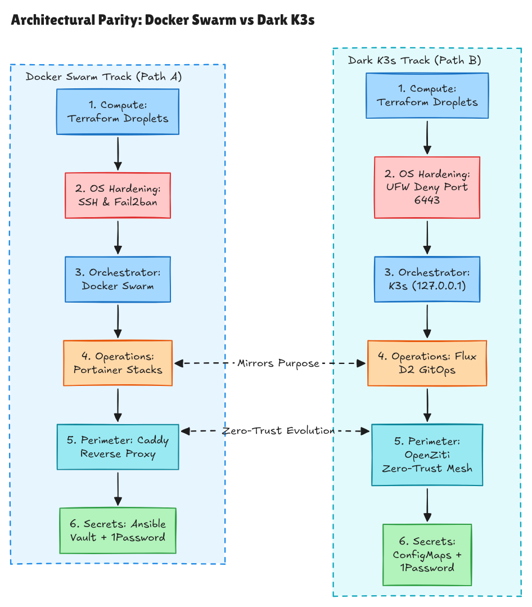

# Infra-Bootstrap-Tools (IBT)

> **Production-grade Infrastructure as Code for homelabs, edge nodes, and self-hosted clouds — from minimalist Docker Swarm to Zero-Trust Kubernetes GitOps.**

[](https://xnok.github.io/infra-bootstrap-tools/)
[](https://galaxy.ansible.com/ui/repo/published/xnok/infra_bootstrap_tools/)
[](https://nixos.org)
[](https://k3s.io)
[](https://openziti.io)
[](https://docs.docker.com/engine/swarm/)
[](https://www.terraform.io/)
[](./LICENSE)

---

## 🎯 Reusable Deliverables & Artifacts

Infra-Bootstrap-Tools produces concrete, production-ready deliverables that you can consume directly in your own infrastructure:

| Deliverable | Description | Location / Install Command |
| :--- | :--- | :--- |
| **🌐 Documentation Website** | Full architecture guides, interactive runbooks, and diagrams | [xnok.github.io/infra-bootstrap-tools](https://xnok.github.io/infra-bootstrap-tools/) |
| **📦 Ansible Galaxy Collection** | Battle-tested roles for Docker, Swarm, K3s, UFW hardening, and Flux | `ansible-galaxy collection install xnok.infra_bootstrap_tools` |
| **🚢 OCI GitOps Fleet Artifacts** | Versioned Flux D2 manifests & platform add-ons on GitHub Packages | `oci://ghcr.io/xnok/infra-bootstrap-tools/manifests/...` |
| **🐳 Production Compose Stacks** | Caddy (automated Let's Encrypt + OAuth portal), Portainer CE, Rclone | [`stacks/`](./stacks/) |
| **🧪 Local Test Harness** | Zero-cost Kind + local OCI registry integration test environment | `make k3s-test` (`bin/tests/flux-d2/test.sh`) |

---

## 🏛️ Architecture: The Dual-Orchestration Model

Infrastructure is not one-size-fits-all. A simple personal homelab does not warrant the overhead of an enterprise control plane. Conversely, complex multi-service architectures demand declarative GitOps, fine-grained RBAC, and zero-trust perimeter isolation.

`infra-bootstrap-tools` maintains strict **architectural parity** across two distinct orchestration tracks:



### Choosing Your Track

| Concern | Docker Swarm Track (Pragmatic Homelab) | Kubernetes Track (Dark K3s & GitOps) |
| :--- | :--- | :--- |
| **Design Philosophy** | Minimalist, single-binary, low operational overhead | Enterprise GitOps & Zero-Trust defense-in-depth |
| **Control Plane** | Docker Swarm internal Raft manager | K3s server bound strictly to `127.0.0.1` |
| **Perimeter & Ingress** | **Caddy**: Open ports 80/443, automated Let's Encrypt TLS | **OpenZiti**: Zero public ports; API is completely dark |
| **Workload Definition** | Docker Compose / Stack files (`deploy:` stanza) | Kustomize Components & HelmReleases via Flux |
| **Cluster Operations** | **Portainer**: Graphical web management dashboard | **FluxCD Operator**: Branchless OCI GitOps reconciliation |
| **Recommended For** | Low-spec hardware, utility containers, rapid homelabs | Production homelabs, GitOps workflows, zero-trust edge |

---

## 🚀 10-Minute Quickstart

### 1. Enter the Hermetic Nix Environment
Avoid tool version conflicts by entering our pre-configured [Nix](https://nixos.org) development shell:

```bash
# For Ansible & Swarm deployment:
nix develop .#ansible

# For Kubernetes, Flux, and Kind testing:
nix develop .#flux

# Full unified environment:
nix develop .#full
```

*(If you use `direnv`, run `direnv allow` once to load dependencies automatically on directory entry).*

### 2. Configure Credentials
Generate template secrets or connect via [1Password CLI](https://developer.1password.com/docs/cli/):
```bash
./bin/bash/setup-secrets.sh
```

### 3. Deploy Your Chosen Track

```bash
# Track A: Deploy Docker Swarm on Cloud VMs (DigitalOcean / AWS)
make swarm-up

# Track B1: Run Zero-Cost Local Kubernetes Validation (Kind + Local Registry)
make k3s-test

# Track B2: Deploy Dark K3s on Cloud VMs
make k3s-up

# Teardown Cloud Infrastructure
make down
```

For the complete step-by-step walkthrough, see the **[Getting Started Runbook](https://xnok.github.io/infra-bootstrap-tools/docs/getting-started-deploy-your-infrastructure/)**.

---

## 🛠️ Using & Contributing to This Monorepo Layout

If you are using this repository as a template for your own infrastructure or contributing changes, the monorepo is organized into clear functional layers:

### Monorepo Directory Layout

```
.
├── ansible/                  # Ansible Collection: xnok.infra_bootstrap_tools
│   ├── playbooks/            # Orchestrator entrypoints (main.yml, k3s.yml, docker-swarm.yml)
│   └── roles/                # Modular roles (docker, k3s_server, k3s_os_hardening, etc.)
├── kubernetes/               # Enterprise Flux D2 GitOps Layout
│   ├── fleet/                # Per-cluster manifests & values (k3s, kind)
│   └── infra-addons/         # Opt-in Kustomize components (cert-manager, openziti, keycloak)
├── terraform/                # Cloud VM and networking provisioning (DigitalOcean, AWS)
├── stacks/                   # Docker Swarm Compose application stacks
├── website/                  # Hugo documentation source (published to GitHub Pages)
└── docs/                     # PARA Docs-as-Code knowledge management & active project notes
```

### Development Standards & Quality Gates

- **Hermetic Toolchains**: Managed via Nix Flakes in `flake.nix`.
- **Pre-commit Automation**: Enforces yamllint, shellcheck, and ansible-lint before commits (`.pre-commit-config.yaml`).
- **Release Automation via Changesets**:
  Every change that modifies packages creates an intentional changelog entry:
  ```bash
  npx changeset add
  ```
  GitHub Actions automatically versions packages, updates changelogs, tags releases, and publishes the Ansible Collection to Ansible Galaxy.
- **Docs-as-Code (PARA Method)**:
  Active tasks and architectural decisions are captured in `docs/1-projects/` before code is committed, ensuring zero hidden knowledge.

---

## 📚 DevOps & Cloud Infrastructure Learning Plan

This repository acts as an interactive curriculum for learning modern infrastructure engineering, pairing hands-on code with in-depth technical writeups:

### Level 1: Foundations (DevOps 101)
* 🏭 **[Provisioning VMs on DigitalOcean with Terraform](https://faun.pub/how-to-provision-vms-on-digitalocean-with-terraform-898515a0dbbc)**: Declarative cloud compute and networking.
* 🔏 **[Creating SSH Keys & GitHub Environments with Terraform](https://faun.pub/how-to-configure-github-environments-with-terraform-d2b76766547b)**: Cryptographic state management and secret isolation.
* 🗺️ **[Generating Ansible Inventory from Terraform](https://faun.pub/how-to-create-ansible-inventory-with-terraform-a32fcbe11be6)**: Bridging infrastructure provisioning and configuration management.
* 👩 **[Running Ansible Playbooks via GitHub Actions](https://faun.pub/how-to-run-an-ansible-playbook-using-github-action-42430dec944)**: Automated CI/CD execution patterns.

### Level 2: Docker Swarm & Edge Ingress
* 🧰 **[Disposable Local Test Environments with Vagrant](https://faun.pub/a-disposable-local-test-environment-is-essential-for-devops-sysadmin-af97fa8f3db0)**: Safe pre-flight playbook testing ([Companion Code](./.articles/1_vagrant_101)).
* 🐳 **[Multi-Node Clustering on Docker Swarm with Ansible](https://faun.pub/experimenting-on-docker-swarm-with-vagrant-and-ansible-bcc2c79ba7c4)**: Raft quorums and overlay networks ([Companion Code](./.articles/2_docker_swarm_101)).
* 🏃‍♂️ **[Zero-Downtime Docker Secret Rotation with Ansible](https://medium.com/itnext/rotating-docker-swarm-secrets-with-ansible-cbaddfdd8ee9)**: Rolling container updates without secrets leaking to disk.
* 🔒 **[Automated SSL & Ingress with Caddy](https://xnok.github.io/infra-bootstrap-tools/docs/caddy/)**: Reverse proxying, automated certificates, and OAuth portals.
* 📊 **[Cluster Operations with Portainer](https://xnok.github.io/infra-bootstrap-tools/docs/portainer/)**: Visual management dashboards and container metrics.

### Level 3: Zero-Trust Kubernetes & Enterprise GitOps
* 🛡️ **[Host Hardening & UFW Default-Deny Policies](https://xnok.github.io/infra-bootstrap-tools/docs/kubernetes/k3s-ansible-bootstrap/)**: Defense-in-depth, CNI isolation, and port lockdown.
* 🌑 **[Hiding the Kubernetes API Server Behind OpenZiti](https://xnok.github.io/infra-bootstrap-tools/blog/dark-k3s-zero-trust/)**: Why port 6443 should never be public, and how overlay networks eliminate port-scanning vulnerabilities.
* 🔄 **[Enterprise GitOps with Flux D2 & OCI](https://xnok.github.io/infra-bootstrap-tools/docs/kubernetes/flux-d2-gitops/)**: Gitless monorepo syncing, values layering rules, and immediate ConfigMap watch reconciliation.
* 🧪 **[Reproducing Production Locally with Kind](https://xnok.github.io/infra-bootstrap-tools/docs/kubernetes/local-testing-kind/)**: Local OCI artifact pushes and deep validation assertions without cloud bills.
* ⚡ **[Safe IaC: Pull-Request Locking for Ansible](https://medium.com/itnext/safe-infrastructure-as-code-github-actions-workflow-with-a-pr-lock-27bef636f852)** & **[Speeding up Playbooks by Running Affected Roles](https://medium.com/itnext/speedup-ansible-playbook-merge-request-by-only-running-affected-roles-42d9ca3f6433)**: Concurrency guards and selective execution in CI.

---

## 🤝 Contributing & Community

Contributions, issue reports, and feature proposals are welcome!

1. Check open issues or create a project note in `docs/1-projects/`.
2. Enter the development shell (`nix develop`).
3. Create a changeset for your contribution (`npx changeset add`).
4. Submit a Pull Request against `main`.

Explore the complete documentation site at **[https://xnok.github.io/infra-bootstrap-tools/](https://xnok.github.io/infra-bootstrap-tools/)**.
