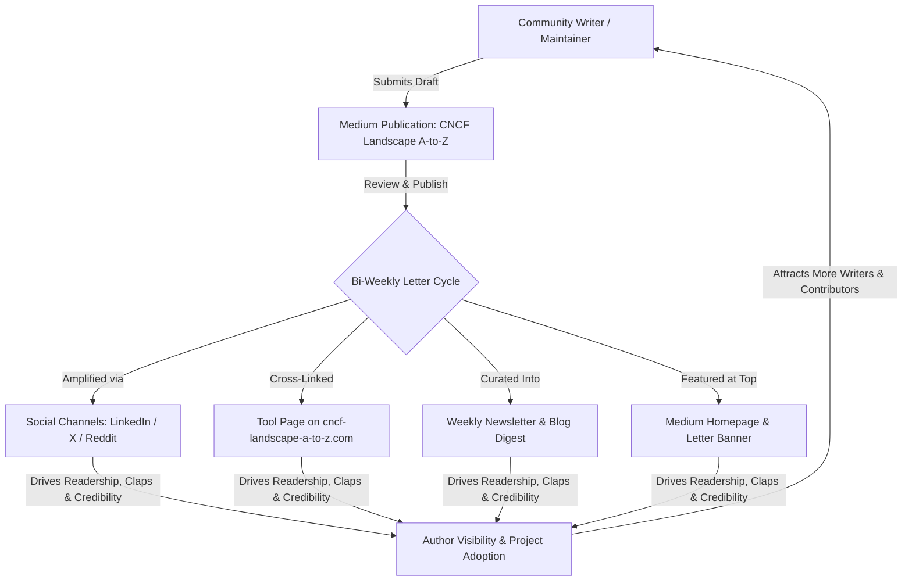

# Project: CNCF Landscape A-to-Z (Medium Publication & Flywheel)

## Executive Summary

The **[CNCF Landscape](https://landscape.cncf.io/)** comprises more than 1,000 projects spanning cloud runtimes, orchestration, observability, security, and AI infrastructure. For developers, platform engineers, and site reliability engineers, navigating this sprawling ecosystem can be overwhelming.

**CNCF Landscape A-to-Z** breaks down this universe one letter at a time over a structured 52-week annual journey (spending two weeks on each letter from A to Z).

To scale coverage and transform this into a sustainable, community-driven educational engine, the **[CNCF Landscape A-to-Z Medium Publication](https://medium.com/cncf-landscape-a-to-z)** serves as an open, collaborative publishing hub. Together with the companion directory at **[cncf-landscape-a-to-z.com](https://cncf-landscape-a-to-z.com/)**, it powers a **Community Knowledge Flywheel** where practitioners share practical stories, gain visibility, and build collective cloud-native expertise.

---

## Mission & Core Values

1. **Demystify Without Gatekeeping**: Break complex cloud-native architectures into actionable, digestible articles.
2. **100% CNCF Focused**: Everything in the CNCF Landscape (Graduated, Incubating, Sandbox, or listed ecosystem project) is fair game.
3. **All Formats Welcome**: We encourage deep dives, hands-on tutorials, side-by-side tool comparisons, architecture blueprints, and raw production war stories.
4. **Community Flywheel**: Every article contributed by the community is amplified across Medium, the website directory, weekly newsletters, and social channels.

---

## The Community Knowledge Flywheel

The flywheel connects writing, directory discovery, and audience distribution into a compounding loop:

### The 4 Flywheel Gears:
1. **The Medium Publication**: A high-domain-authority, zero-friction publishing outlet for engineers and maintainers.
2. **The Tool Directory (`cncf-landscape-a-to-z.com`)**: A permanent reference index where each tool's page embeds and backlinks directly to matching community Medium articles.
3. **The Bi-Weekly Newsletter**: Curated roundups sent to subscribers highlighting top stories, tutorials, and ecosystem updates.
4. **Social & Maintainer Amplification**: Tagging project maintainers, CNCF tags, and community forums (Reddit, CNCF Slack), creating organic virality.

---

## Detailed Project Documents

To execute this strategy smoothly, the project documentation is organized into modular playbooks:

* 🛠️ **[Our Repo CNCF Contributions & Article Backlog](cncf-landscape-a-to-z/repo-cncf-contributions.md)**: Direct inventory of CNCF tools implemented in this repository, code references, and complete article pitches.
* 📅 **[52-Week Editorial Calendar](cncf-landscape-a-to-z/editorial-calendar-52-weeks.md)**: Week-by-week mapping of letters A through Z, featured anchor projects (Graduated, Incubating, Sandbox), and thematic schedules.
* ✍️ **[Community Contributor Guide](cncf-landscape-a-to-z/contributor-guide.md)**: Step-by-step writer onboarding, submission workflow, editorial quality rubric, and writer perks.
* 📝 **[Article Templates & Blueprints](cncf-landscape-a-to-z/article-templates.md)**: Ready-to-use markdown templates for Quickstarts, Deep Dives, Tool Showdowns, Production War Stories, and Bi-Weekly Roundups.
* 🚀 **[Growth & Distribution Flywheel Operations](cncf-landscape-a-to-z/growth-and-flywheel.md)**: Checklists and templates for social promo, maintainer outreach, directory cross-linking, and newsletter syndication.

---

## What We Contribute: CNCF Tools in This Repository

Rather than writing purely theoretical articles, our primary contributions stem directly from the architectures, automation, and operational runbooks built inside `infra-bootstrap-tools`:

1. **Flux CD (Graduated, Letter F/O)**:
   * *Pitch*: "Gitless GitOps" — How we implemented the ControlPlane Flux D2 architecture in a monorepo, packaging Kubernetes fleet configurations as immutable OCI artifacts on GHCR (`bin/ci/publish-flux-artifact.sh`) rather than tracking Git branches.
2. **K3s (Sandbox, Letter K/Z)**:
   * *Pitch*: The "Dark K3s Stack" — Running production K3s with zero open inbound public ports, binding the API server strictly to `127.0.0.1` and tunneling all access through OpenZiti zero-trust networking (`ansible/roles/k3s_server`, `ansible/roles/k3s_os_hardening`).
3. **Helm (Graduated, Letter H)**:
   * *Pitch*: The GitOps Trap — Why you should never hardcode `spec.values` in Flux HelmReleases, and how our two-tier ConfigMap layering pattern (`default-<addon>-values` + cluster override ConfigMap) enables clean fleet customization.
4. **KinD (K8s SIGs / CNCF, Letter K)**:
   * *Pitch*: Ephemeral GitOps CI — How we run end-to-end Flux D2 reconciliation tests locally in under 3 minutes (`make test-flux-d2`) by attaching a local Docker registry on port 5001 with containerd CRI registry mirror patches.
5. **Open Policy Agent / OPA (Graduated, Letter O/P)**:
   * *Pitch*: Policy-as-Code for CI — Using custom Rego rules (`policies/ci/inline_scripts.rego`) to ban multi-line spaghetti bash in GitHub Actions workflows, forcing modular script extraction into `bin/ci/`.
6. **Cosign / Sigstore (Graduated, Letter C/S)**:
   * *Pitch*: Monorepo Supply Chain Security — Automatically signing OCI container image digests in GitHub Actions (`bin/ci/sign-docker-image.sh`) and attaching cryptographic audit records to GitHub Step Summaries.
7. **cert-manager & trust-manager (Graduated, Letter C/T)**:
   * *Pitch*: Beyond Ingress TLS — Managing internal zero-trust mutual TLS and synchronizing CA trust bundles across cluster namespaces using modular Kustomize Components (`kubernetes/infra-addons/components/cert-manager`).
8. **Kustomize (K8s SIGs / CNCF, Letter K)**:
   * *Pitch*: Stop Duplicating Overlays — Composing modular cluster addons dynamically using Kustomize `kind: Component` (`kubernetes/infra-addons/components/`).

---

## Target Audience & Personas

| Persona | Primary Needs | Ideal Content Formats |
| :--- | :--- | :--- |
| **Platform Engineers** | Scalability, multi-tenancy, GitOps, Kubernetes extensibility | Deep dives, architecture breakdowns, CRD & Operator comparisons |
| **DevOps & SREs** | Observability, CI/CD pipelines, reliability, disaster recovery | Hands-on tutorials, production post-mortems, tool showdowns |
| **Cloud-Native Developers** | Local dev loops, microservices communication, cloud SDKs | 101 Quickstarts, code walkthroughs, CLI tool reviews |
| **Engineering Leaders** | Tool consolidation, license risks, maintenance cost, maturity | CNCF maturity overviews, ecosystem trend analysis |
| **OSS Maintainers** | Project adoption, user onboarding, contributor recruitment | Feature announcements, architecture overviews, migration guides |

---

## Key Performance Indicators (KPIs)

* **Readership & Reach**: Monthly reads, average view duration (>3 min), member read time on Medium.
* **Flywheel Velocity**: Active community writers onboarded per month, submissions received per 2-week letter block.
* **Directory Conversion**: Backlink clicks from `cncf-landscape-a-to-z.com` tool pages to Medium stories.
* **Ecosystem Coverage**: % of CNCF Graduated & Incubating projects covered by at least one dedicated story within 52 weeks.
* **Community Engagement**: Maintainer reshares, GitHub issues/discussions submitted via the website.

---

## Operational Rhythm

* **Every 2 Weeks (Monday)**: Transition to the next letter. Publish the "Letter Launch & Landscape Overview".
* **Bi-Weekly (Mid-Sprint)**: Publish Flagship Deep Dive and curated community submissions.
* **Every 2 Weeks (Sunday)**: Publish the "Bi-Weekly Roundup & Community Highlights" across Medium, the website blog, and the newsletter.
* **Continuous**: Review inbound writer requests (within 24–48 hours) and stage draft submissions into the publication pipeline.
