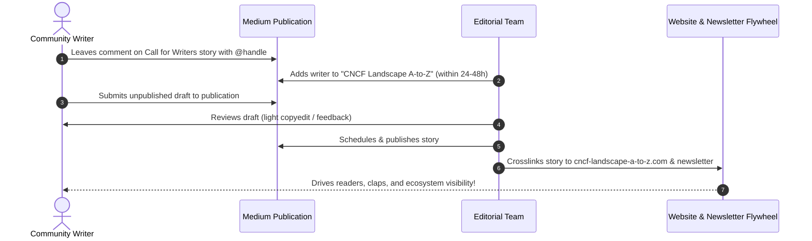

# CNCF Landscape A-to-Z: Community Contributor Guide

Welcome to the **[CNCF Landscape A-to-Z Medium Publication](https://medium.com/cncf-landscape-a-to-z)**! 

Our goal is to build an open, collaborative knowledge flywheel that demystifies over 1,000 cloud-native technologies. Whether you are a project maintainer, an experienced platform engineer, a DevOps practitioner, or a beginner documenting your learning journey, we would love to publish your work!

---

## The Golden Rule: 100% CNCF Goes!

Our editorial policy is straightforward:

1. **CNCF Landscape Required**: Your article must cover at least one project, tool, or initiative listed on the official **[CNCF Landscape](https://landscape.cncf.io/)** (Graduated, Incubating, Sandbox, or listed ecosystem project).
2. **All Formats Welcome**: We publish:
   * **Deep Dives**: Architectural breakdowns and internal mechanics.
   * **Hands-on Tutorials & 101s**: Step-by-step guides with working code or manifests.
   * **Tool Comparisons / Showdowns**: Objective, side-by-side trade-off evaluations.
   * **Production Post-Mortems & War Stories**: Real-world lessons, outage triage, or scale hurdles.
   * **Emerging Tool Spotlights**: Exploring newer sandbox projects.
3. **Practitioner First**: Content must provide genuine educational value. We do not accept purely promotional vendor sales pitches without technical depth.

---

## Step-by-Step: How to Become a Writer & Submit



### Step 1: Request Writer Access
1. Visit our official **[Call for Writers story](https://medium.com/cncf-landscape-a-to-z/call-for-writers-cncf-landscape-a-to-z-4ddfac98f336)**.
2. Leave a quick comment with your Medium handle:
   > *"Hi! I'd like to write about [Tool Name] for Letter [Letter]. Please add me as a writer: @yourusername"*
3. Our editorial team will add you as a writer within **24–48 hours**.

### Step 2: Prepare Your Draft
* Write your article as an **unpublished Medium draft** (or import a markdown post from your personal blog).
* Structure your article using one of our proven **[Article Templates](article-templates.md)**.
* Check the **Editorial Quality Rubric** below before submitting.

### Step 3: Submit to the Publication
1. In your Medium draft editor, click the three dots (**`...`**) in the upper-right corner.
2. Select **Add to publication**.
3. Choose **CNCF Landscape A-to-Z** from the list.
4. Click **Select and continue**, then click **Submit to publication**.

### Step 4: Editorial Review
* Our editors review submissions for technical accuracy, formatting, and readability.
* Minor edits (typos, tag optimization) may be made directly. If major feedback is needed, we will leave private notes on your draft.
* Accepted drafts are scheduled to go live during the corresponding letter week or added to the active publishing queue!

---

## Editorial Standards & Best Practices

### 1. Title, Subtitle & Featured Image
* **Title**: Clear, descriptive, and actionable. Avoid vague clickbait.
  * *Great*: "Demystifying Cilium eBPF: How Packet Filtering Works Under the Hood"
  * *Poor*: "Why I Love Cilium"
* **Subtitle**: A 1-2 sentence summary that expands on the title and informs the reader what they will learn.
* **Featured Image**: High-resolution image (16:9 or 2:1 aspect ratio) placed directly beneath the subtitle. Always credit the source (Unsplash, project logo, or author-created diagram).

### 2. Article Structure & Headings
* Use a clear heading hierarchy (`## Section`, `### Subsection`).
* Keep paragraphs concise (3 to 5 sentences maximum) to maintain readability on mobile devices.
* Include visual breaks: diagrams, callout quotes, tables, and fenced code blocks.

### 3. Code Blocks & Commands
* Always use Medium code blocks with syntax highlighting (type ``` or press `Ctrl + Alt + 6` / `Cmd + Option + 6`).
* Ensure manifests and configuration snippets are complete and runnable.
* Avoid dumping 300 lines of unbroken YAML; explain key parameters directly beneath the snippet.

### 4. Diagrams & Architecture
* Cloud-native concepts thrive on diagrams! Include diagrams created with tools like **Mermaid**, **Excalidraw**, **D2**, or **Draw.io**.
* Export diagrams in high resolution with light or high-contrast backgrounds.

### 5. Medium Tags
Include up to 5 relevant tags when submitting your draft. We recommend:
1. `DevOps` or `Cloud Native`
2. `Kubernetes`
3. Primary project name (e.g., `Argo CD`, `Prometheus`, `Cilium`)
4. Functional area (e.g., `Observability`, `GitOps`, `Security`)
5. `CNCF Landscape`

### 6. Canonical Links (Cross-Posting)
If you originally published the article on your personal blog or company website:
* Go to Medium story settings -> **Advanced Settings** -> **Customize canonical link**.
* Input your original article URL. This ensures your personal domain retains full SEO credit with Google.

---

## Editorial Quality Rubric

Every submission is reviewed against four core criteria:

| Criteria | Expectations |
| :--- | :--- |
| **Technical Accuracy** | Code blocks, CLI flags, and architectural statements are verified and reflect current tool versions. |
| **Clarity & Flow** | Explains the "why" before diving into the "how". Concepts are explained without assuming obscure prior knowledge. |
| **Objective Evaluation** | Acknowledges trade-offs, limitations, and resource footprints rather than presenting tools as silver bullets. |
| **Originality & Authenticity** | Original practitioner insights. Pure AI-generated text or unverified scrapings are rejected. |

---

## Why Write With Us? (Writer Perks)

When your story is published in *CNCF Landscape A-to-Z*, we activate our cross-channel amplification engine:

1. 🌟 **Featured Letter Placement**: If your article aligns with the active letter on our schedule (e.g., Argo during Letter 'A'), it is pinned and featured at the top of the publication.
2. 🔗 **Permanent Tool Directory Backlinks**: Every project in our directory at **[cncf-landscape-a-to-z.com](https://cncf-landscape-a-to-z.com/)** features matching community stories, sending targeted search traffic to your article indefinitely.
3. 📬 **Newsletter Spotlight**: Your story will be featured in our bi-weekly email digest sent to cloud-native practitioners and subscribers.
4. 📣 **Social Media Amplification**: We share published stories across LinkedIn, X/Twitter, and relevant cloud-native discussion channels, tagging you and project maintainers.
5. 👤 **Author Credibility & Bio**: Build your reputation in the cloud-native ecosystem with dedicated author attribution and links to your personal portfolio or GitHub profile.

---

## Questions or Need Help?

* Have an article idea you want to vet first? Open an issue on our [GitHub repository](https://github.com/mekitmedia/cncf-landscape-a-to-z) or leave a private note on our Call for Writers story.
* Let's build the ultimate community-driven guide to the CNCF Landscape together!
