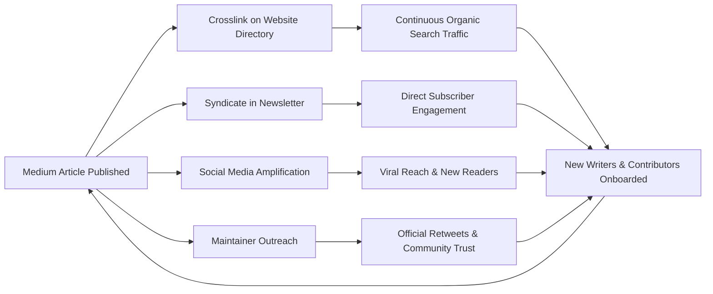

# CNCF Landscape A-to-Z: Growth & Distribution Flywheel Operations

This playbook outlines the distribution mechanics, outreach templates, and cross-channel operations that power the **[CNCF Landscape A-to-Z](https://medium.com/cncf-landscape-a-to-z)** knowledge flywheel.

---

## The Flywheel Architecture

The flywheel transforms individual articles into compounding, long-term traffic and writer acquisition:



---

## 1. Website Directory Cross-Linking Workflow

Every tool listed in our directory at **[cncf-landscape-a-to-z.com](https://cncf-landscape-a-to-z.com/)** features a dedicated project profile. When a community article is published on Medium, editors link it to the corresponding tool profile.

### Operational Steps:
1. Identify the tool's entry in the directory website repo (`mekitmedia/cncf-landscape-a-to-z`).
2. Add the published Medium article to the tool's `articles` metadata frontmatter:
   ```yaml
   articles:
     - title: "Demystifying Cilium eBPF: How Packet Filtering Works"
       author: "Alexandre Couëdelo"
       url: "https://medium.com/cncf-landscape-a-to-z/demystifying-cilium-ebpf-..."
       date: "2026-03-30"
       type: "deep-dive"
   ```
3. Commit and push changes. The automated Hugo build will render the story under the **"Community Articles & Deep Dives"** section on the tool's live page.
4. If the article corresponds to the **active letter week**, feature it as the top banner story on the letter index page.

---

## 2. Social Amplification Engine

### A. X / Twitter Thread Blueprint

* **Hook (Tweet 1)**: Problem statement + core promise.
  > 🧵 Navigating the @CloudNativeFdn landscape can be overwhelming. Today, we're demystifying **[Tool Name]** for Letter **[X]** in our #CNCF Landscape A-to-Z series!  
  >  
  > Here is how [Tool Name] solves [Core Challenge] under the hood 👇 [Link to Story]
* **Architecture (Tweet 2)**: Visual architecture diagram image + 2-3 sentence explanation of the control plane and data plane.
* **Key Takeaway (Tweet 3)**: The #1 thing engineers get wrong or the biggest performance win.
* **Trade-Offs (Tweet 4)**: When you should use it vs. when to pick an alternative.
* **Credits & CTA (Tweet 5)**:
  > Big thanks to @[AuthorHandle] for writing this practical breakdown in @CNCF_AtoZ!  
  >  
  > Explore the full directory of tools starting with [Letter] here: https://cncf-landscape-a-to-z.com/letters/[letter]/  
  >  
  > Want to write about your favorite CNCF tool? Drop us a comment! 🚀

---

### B. LinkedIn Post / Carousel Blueprint

* **Headline**: Bold, practitioner-focused question.
  > *Are you running [Tool Category] in production, or are you still relying on legacy approaches?*
* **Body**:
  > As part of our 52-week **CNCF Landscape A-to-Z** initiative, we're diving into Letter **[X]**: spotlighting **[Tool Name]**.  
  >  
  > In this in-depth walkthrough by [Author Name], we break down:  
  > 🔹 Why [Tool Name] was built and how its architecture operates  
  > 🔹 Key metrics and configuration gotchas when scaling in Kubernetes  
  > 🔹 A head-to-head comparison against [Alternative Tool]  
  >  
  > Read the full breakdown on Medium: [Article URL]  
  >  
  > Check out all [Letter] tools in our interactive directory: https://cncf-landscape-a-to-z.com/  
  >  
  > #Kubernetes #CloudNative #DevOps #SRE #PlatformEngineering #CNCF
* **Visual**: Attach a multi-page PDF carousel or high-resolution architecture diagram.

---

### C. Reddit Community Sharing Guidelines

When sharing content to technical subreddits (`r/kubernetes`, `r/devops`, `r/cloudnative`), avoid raw link drops which violate self-promotion rules.

* **Format**: Publish a **comprehensive text post** containing the actual technical summary, code snippets, and architecture explanation.
* **Attribution at bottom**:
  > *Originally published as part of the community-driven CNCF Landscape A-to-Z series. If you'd like to check out the diagrams and full walkthrough, you can read it here: [Medium URL]. Feel free to share feedback or questions below!*

---

## 3. CNCF Maintainer Outreach Protocol

Project maintainers love seeing high-quality, community-created content about their tools. Engaging them expands reach to the project's core user base.

### Email / Slack Outreach Template:
* **Subject**: *Featured [Tool Name] in the CNCF Landscape A-to-Z Series!*
* **Channel**: CNCF Slack (`#project-name` or direct message to maintainers), GitHub discussion, or Twitter DM.
* **Message**:
  > Hi [Maintainer Name / Team],  
  >  
  > We recently featured **[Tool Name]** as part of our **CNCF Landscape A-to-Z** 52-week community educational series!  
  >  
  > One of our community contributors ([Author Name]) wrote a practical deep-dive:  
  > 📖 **[Article Title]** ([Medium URL])  
  >  
  > We also host a dedicated interactive profile for [Tool Name] on our directory:  
  > 🔗 https://cncf-landscape-a-to-z.com/tools/[tool-slug]/  
  >  
  > If you have any feedback or notice anything that could be updated, please let us know. If you like the article, we'd be thrilled if you shared it with the community or retweeted it!  
  >  
  > Thanks for all your work on [Tool Name]!  
  > Best regards,  
  > Alexandre & The CNCF Landscape A-to-Z Team

---

## 4. Newsletter Syndication Engine

The bi-weekly email newsletter serves as the glue keeping readers engaged between letter releases.

### Standard Newsletter Layout:
1. **The Letter in Focus**: Progress milestone (e.g., *"Week 45 of 52: Unlocking Letter 'W'"*).
2. **Editor's Note**: Quick perspective on industry shifts or news relevant to the letter's categories.
3. **Featured Deep Dive**: The primary architectural article with a 2-paragraph teaser and "Read on Medium" button.
4. **Community Spotlight**: 2–3 community submissions covering other tools under the letter.
5. **Interactive Directory Highlight**: Direct link to explore all tools under the letter on `cncf-landscape-a-to-z.com`.
6. **Call for Writers Banner**: Prompt encouraging readers to claim upcoming letters.

---

## 5. Monthly Retrospective & Growth Checklist

On the first Monday of each month, the editorial team reviews:

* [ ] **Readership Growth**: Total Medium reads, claps, and publication follower growth.
* [ ] **Writer Funnel**: How many new writers requested access? Average time from request to first published draft.
* [ ] **Tool Page Backlinks**: Verify all newly published articles are linked from their matching `cncf-landscape-a-to-z.com` tool pages.
* [ ] **Upcoming Letters Pipeline**: Ensure the next 2 letters (4 weeks of content) have at least 1 confirmed flagship draft and 2 community submissions in progress.
* [ ] **Maintainer Engagement**: Count how many maintainers or official project accounts reshared or engaged with our posts.
