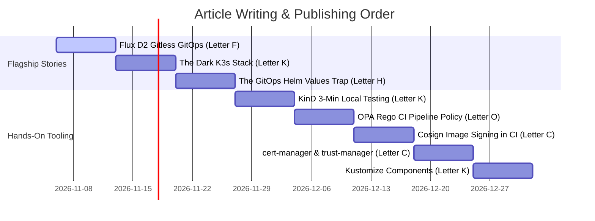

# Repository CNCF Contributions & Article Backlog

This document inventories the concrete **Cloud Native Computing Foundation (CNCF)** technologies, architectures, and scripts implemented in `infra-bootstrap-tools`. These serve as our primary original contributions to the **[CNCF Landscape A-to-Z Medium Publication](https://medium.com/cncf-landscape-a-to-z)**.

---

## Tool Matrix & Contribution Inventory

| Tool | CNCF Status | Letter & Category | In-Repo Implementation | Proposed Article Title & Pitch |
| :--- | :--- | :--- | :--- | :--- |
| **Flux CD** | Graduated | **F** (Continuous Delivery) | `kubernetes/fleet/`, `bin/ci/publish-flux-artifact.sh`, `.github/workflows/flux-oci-publish.yml` | *Why We Stopped Syncing Git Branches: Implementing Flux D2 "Gitless GitOps" with OCI Artifacts in a Monorepo* |
| **K3s** | Sandbox | **K** (Orchestration) | `ansible/roles/k3s_server/`, `ansible/roles/k3s_os_hardening/`, `docs/1-projects/dark-k3s-stack.md` | *The "Dark K3s Stack": Running a Production Kubernetes Cluster with Zero Public Inbound Ports* |
| **Helm** | Graduated | **H** (App Definition) | `kubernetes/infra-addons/base/helm-repos.yaml`, `kubernetes-flux-d2.md:L90-100` | *The GitOps Trap: Why You Should Never Use `spec.values` in Flux HelmReleases (And What to Use Instead)* |
| **KinD** | K8s SIGs / CNCF | **K** (Dev Tooling) | `bin/k8s/setup-kind-local-registry.sh`, `bin/kind/config/cluster-with-registry.yaml.tpl`, `Makefile` | *Testing Complex Flux GitOps Pipelines Locally in Under 3 Minutes with KinD and Local Registry Mirrors* |
| **Open Policy Agent (OPA)** | Graduated | **O** / **P** (Policy) | `policies/ci/inline_scripts.rego`, `policies/ci/no_inline_scripts.rego` | *Stop Writing Spaghetti Bash in CI: Enforcing Clean Pipelines with Open Policy Agent (OPA) and Rego* |
| **Cosign (Sigstore)** | Graduated | **C** / **S** (Supply Chain) | `bin/ci/sign-docker-image.sh`, `.github/workflows/release-docker.yml` | *Securing the Monorepo Supply Chain: Signing Container Image Digests with Cosign in GitHub Actions* |
| **cert-manager & trust-manager** | Graduated | **C** / **T** (Security) | `kubernetes/infra-addons/components/cert-manager/`, `fleet/k3s/infra-addons/values/cert-manager.values.yaml` | *Beyond Ingress TLS: Managing Internal CA Trust Bundles with cert-manager and trust-manager* |
| **Kustomize** | K8s SIGs / CNCF | **K** (App Definition) | `kubernetes/infra-addons/components/`, `kubernetes/infra-addons/kustomization.yaml` | *Stop Duplicating Overlays: Composing Modular Cluster Addons with Kustomize Components (`kind: Component`)* |
| **containerd** | Graduated | **C** (Runtime) | `bin/kind/config/cluster-with-registry.yaml.tpl` | *Hacking containerd CRI Registry Mirrors for Ephemeral Local Testing* |

---

## Detailed Article Pitches & Technical Blueprints

### 1. Flux CD: "Gitless GitOps" with OCI Artifacts (Flux D2)
* **Target Letter**: Letter **F** (Flux) or Letter **O** (OCI Artifacts)
* **Format**: Architectural Deep Dive & Blueprint
* **Code References**:
  * Manifest publisher script: [`bin/ci/publish-flux-artifact.sh`](file:///home/xnok/.gemini/antigravity/worktrees/infra-bootstrap-tools/cncf_content_plan_medium/bin/ci/publish-flux-artifact.sh)
  * FluxInstance declaration: [`kubernetes/fleet/k3s/flux-system/flux-instance.yaml`](file:///home/xnok/.gemini/antigravity/worktrees/infra-bootstrap-tools/cncf_content_plan_medium/kubernetes/fleet/k3s/flux-system/flux-instance.yaml)
  * CI publish workflow: [`.github/workflows/flux-oci-publish.yml`](file:///home/xnok/.gemini/antigravity/worktrees/infra-bootstrap-tools/cncf_content_plan_medium/.github/workflows/flux-oci-publish.yml)
  * Reference doc: [`docs/1-projects/kubernetes-flux-d2.md`](file:///home/xnok/.gemini/antigravity/worktrees/infra-bootstrap-tools/cncf_content_plan_medium/docs/1-projects/kubernetes-flux-d2.md)
* **Article Title**:
  > *Why We Stopped Syncing Git Branches: Implementing Flux D2 "Gitless GitOps" with OCI Artifacts in a Monorepo*
* **The Pitch**:
  Traditional GitOps binds clusters directly to Git repository branches. This creates rate-limit headaches with GitHub, introduces Git credential sprawl on Kubernetes nodes, and makes multi-tenant monorepos clunky to reconcile.
  
  In `infra-bootstrap-tools`, we implemented ControlPlane’s **Enterprise Flux D2 Architecture**:
  1. Our CI pipeline pushes `./kubernetes/fleet/<cluster>` and `./kubernetes/infra-addons` as immutable OCI artifacts directly to GitHub Container Registry (`ghcr.io`) using `flux push artifact`.
  2. Fleet clusters pull OCI manifests using `OCIRepository` resources tagged by `$SHORT_SHA` and `latest`.
  3. No Git access tokens or SSH deploy keys exist on the cluster.
  
  *Key Takeaways for Readers*: How to structure a monorepo for OCI packaging, how to configure Flux Operator and `FluxInstance`, and how to orchestrate atomic cluster rollouts.

---

### 2. K3s: The "Dark K3s Stack" (Zero-Trust Kubernetes)
* **Target Letter**: Letter **K** (Kubernetes / K3s) or Letter **Z** (Zero-Trust)
* **Format**: Production Tutorial & Security Hardening Guide
* **Code References**:
  * Project design note: [`docs/1-projects/dark-k3s-stack.md`](file:///home/xnok/.gemini/antigravity/worktrees/infra-bootstrap-tools/cncf_content_plan_medium/docs/1-projects/dark-k3s-stack.md)
  * K3s server Ansible role: [`ansible/roles/k3s_server/`](file:///home/xnok/.gemini/antigravity/worktrees/infra-bootstrap-tools/cncf_content_plan_medium/ansible/roles/k3s_server)
  * UFW firewall hardening role: [`ansible/roles/k3s_os_hardening/`](file:///home/xnok/.gemini/antigravity/worktrees/infra-bootstrap-tools/cncf_content_plan_medium/ansible/roles/k3s_os_hardening)
* **Article Title**:
  > *The "Dark K3s Stack": Running a Production Kubernetes Cluster with Zero Public Inbound Ports*
* **The Pitch**:
  Exposing port `6443` on a public VM or homelab machine exposes the control plane to constant automated scans and brute-force CVE attempts.
  
  In this architecture:
  1. K3s is configured with `INSTALL_K3S_EXEC="--tls-san k3s.ziti --bind-address 127.0.0.1 --disable traefik"`.
  2. UFW blocks incoming traffic to port 6443 from all public interfaces.
  3. Control plane access is provided strictly through an in-cluster **OpenZiti** zero-trust overlay router.
  4. The cluster is completely bootstrapped via Ansible, fetching secrets and tokens directly from 1Password.
  
  *Key Takeaways for Readers*: Step-by-step Ansible playbook design, firewall automation, and how to safely run remote `kubectl` commands against an API server that has no public IP or DNS record.

---

### 3. Helm: The GitOps Trap — Values Layering Done Right
* **Target Letter**: Letter **H** (Helm)
* **Format**: Lessons Learned / Production War Story
* **Code References**:
  * Addon values overrides: [`kubernetes/fleet/k3s/infra-addons/values/`](file:///home/xnok/.gemini/antigravity/worktrees/infra-bootstrap-tools/cncf_content_plan_medium/kubernetes/fleet/k3s/infra-addons/values)
  * Shared Helm repos: [`kubernetes/infra-addons/base/helm-repos.yaml`](file:///home/xnok/.gemini/antigravity/worktrees/infra-bootstrap-tools/cncf_content_plan_medium/kubernetes/infra-addons/base/helm-repos.yaml)
  * Design rule: [`docs/1-projects/kubernetes-flux-d2.md:L90-100`](file:///home/xnok/.gemini/antigravity/worktrees/infra-bootstrap-tools/cncf_content_plan_medium/docs/1-projects/kubernetes-flux-d2.md#L90-L100)
* **Article Title**:
  > *The GitOps Trap: Why You Should Never Use `spec.values` in Flux HelmReleases (And What to Use Instead)*
* **The Pitch**:
  A common and frustrating trap in multi-cluster GitOps: you define a shared `HelmRelease` with baseline values in `spec.values`, and then try to override a value in a specific cluster using `valuesFrom` ConfigMaps. It silently fails—because in Flux Helm Controller, `spec.values` always overrides `valuesFrom`.
  
  Our solution: **The Two-Tier ConfigMap Values Pattern**:
  ```yaml
  valuesFrom:
    - kind: ConfigMap
      name: default-<addon>-values  # Component default — ships with shared infra-addons
    - kind: ConfigMap
      name: override-<addon>-values # Cluster override — generated per fleet cluster
      optional: true
  ```
  
  *Key Takeaways for Readers*: Avoiding HelmRelease configuration bugs, clean separation of base addons vs. cluster overrides, and managing fleet-wide configurations without duplicating Helm values.

---

### 4. KinD: Ephemeral GitOps CI in Under 3 Minutes
* **Target Letter**: Letter **K** (KinD)
* **Format**: Hands-On Developer Workflow
* **Code References**:
  * Kind + registry setup script: [`bin/k8s/setup-kind-local-registry.sh`](file:///home/xnok/.gemini/antigravity/worktrees/infra-bootstrap-tools/cncf_content_plan_medium/bin/k8s/setup-kind-local-registry.sh)
  * containerd mirror patch template: [`bin/kind/config/cluster-with-registry.yaml.tpl`](file:///home/xnok/.gemini/antigravity/worktrees/infra-bootstrap-tools/cncf_content_plan_medium/bin/kind/config/cluster-with-registry.yaml.tpl)
  * Test script: [`bin/tests/flux-d2/test.sh`](file:///home/xnok/.gemini/antigravity/worktrees/infra-bootstrap-tools/cncf_content_plan_medium/bin/tests/flux-d2/test.sh)
  * Makefile target: [`Makefile:L42-47`](file:///home/xnok/.gemini/antigravity/worktrees/infra-bootstrap-tools/cncf_content_plan_medium/Makefile#L42-L47)
* **Article Title**:
  > *Testing Complex Flux GitOps Pipelines Locally in Under 3 Minutes with KinD and Local Registry Mirrors*
* **The Pitch**:
  Testing GitOps by waiting for cloud CI runners or remote staging clusters ruins developer flow. We built a local test harness (`make test-flux-d2`) that:
  1. Provisions a local KinD cluster connected to a local Docker container registry on port 5001.
  2. Patches `containerd` CRI registry mirrors inside the KinD node so pods pull directly from `localhost:5001`.
  3. Pushes local manifests as OCI packages via `flux push artifact`.
  4. Verifies Flux reconciliation, cert-manager readiness, and OpenZiti controller/router deployment in 180 seconds.
  
  *Key Takeaways for Readers*: How to wire KinD with a local registry, containerd mirror configuration, and writing deterministic bash assertion scripts for GitOps CI.

---

### 5. Open Policy Agent (OPA): Policy-as-Code for CI Pipelines
* **Target Letter**: Letter **O** (Open Policy Agent) or Letter **P** (Policy-as-Code)
* **Format**: Practical Tutorial & CI Best Practice
* **Code References**:
  * Rego policy: [`policies/ci/inline_scripts.rego`](file:///home/xnok/.gemini/antigravity/worktrees/infra-bootstrap-tools/cncf_content_plan_medium/policies/ci/inline_scripts.rego)
  * Companion policy: [`policies/ci/no_inline_scripts.rego`](file:///home/xnok/.gemini/antigravity/worktrees/infra-bootstrap-tools/cncf_content_plan_medium/policies/ci/no_inline_scripts.rego)
* **Article Title**:
  > *Stop Writing Spaghetti Bash in CI: Enforcing Clean Pipelines with Open Policy Agent (OPA) and Rego*
* **The Pitch**:
  GitHub Actions workflows easily devolve into unreadable, untestable 100-line inline bash scripts inside `run:` blocks.
  
  We enforce CI hygiene using Open Policy Agent (`conftest`):
  * A custom Rego rule parses every workflow file under `.github/workflows/`.
  * If any `run:` step contains a newline character (`\n`), the CI build fails with:
    `"Job '<job>' step '<step>' contains a multiline inline script. Please extract this into a dedicated script in the bin/ci directory."`
  
  *Key Takeaways for Readers*: Writing AST-based Rego policies for YAML pipelines, shifting CI testing left, and making CI scripts locally runnable and debuggable.

---

### 6. Cosign (Sigstore): Keyless Container Signing in Monorepo CI
* **Target Letter**: Letter **C** (Cosign) or Letter **S** (Sigstore)
* **Format**: Practical Security Guide
* **Code References**:
  * Signing script: [`bin/ci/sign-docker-image.sh`](file:///home/xnok/.gemini/antigravity/worktrees/infra-bootstrap-tools/cncf_content_plan_medium/bin/ci/sign-docker-image.sh)
  * Release workflow: [`.github/workflows/release-docker.yml`](file:///home/xnok/.gemini/antigravity/worktrees/infra-bootstrap-tools/cncf_content_plan_medium/.github/workflows/release-docker.yml)
* **Article Title**:
  > *Securing the Monorepo Supply Chain: Signing Container Image Digests with Cosign in GitHub Actions*
* **The Pitch**:
  Signing container images shouldn't require managing fragile long-lived GPG keys or hardware tokens. We demonstrate how our release workflows sign container digests directly using Cosign in GitHub Actions (`cosign sign --yes {}@${DIGEST}`), producing verifiable cryptographic audit records directly in GitHub Step Summaries.
  
  *Key Takeaways for Readers*: Keyless OIDC-based signing in GitHub Actions, signing by digest instead of mutable tags, and automated verification before deployment.

---

### 7. cert-manager & trust-manager: Internal CA & Trust Bundles
* **Target Letter**: Letter **C** (cert-manager) or Letter **T** (trust-manager)
* **Format**: Hands-On Architectural Guide
* **Code References**:
  * Kustomize component: [`kubernetes/infra-addons/components/cert-manager/`](file:///home/xnok/.gemini/antigravity/worktrees/infra-bootstrap-tools/cncf_content_plan_medium/kubernetes/infra-addons/components/cert-manager)
  * Values overrides: [`kubernetes/fleet/k3s/infra-addons/values/cert-manager.values.yaml`](file:///home/xnok/.gemini/antigravity/worktrees/infra-bootstrap-tools/cncf_content_plan_medium/kubernetes/fleet/k3s/infra-addons/values/cert-manager.values.yaml)
* **Article Title**:
  > *Beyond Ingress TLS: Managing Internal CA Trust Bundles with cert-manager and trust-manager*
* **The Pitch**:
  Most developers stop at using cert-manager for public Let's Encrypt certificates. In internal zero-trust architectures, you need internal private CAs and automatic synchronization of root certificates across dozens of namespaces. We show how cert-manager and trust-manager work together as a modular Kustomize component to maintain cluster-wide trust without manual secret copying.

---

### 8. Kustomize: Modular Cluster Addons with `kind: Component`
* **Target Letter**: Letter **K** (Kustomize)
* **Format**: Architecture & Pattern Guide
* **Code References**:
  * Addons layout: [`kubernetes/infra-addons/`](file:///home/xnok/.gemini/antigravity/worktrees/infra-bootstrap-tools/cncf_content_plan_medium/kubernetes/infra-addons)
  * Root kustomization: [`kubernetes/infra-addons/kustomization.yaml`](file:///home/xnok/.gemini/antigravity/worktrees/infra-bootstrap-tools/cncf_content_plan_medium/kubernetes/infra-addons/kustomization.yaml)
* **Article Title**:
  > *Stop Duplicating Overlays: Composing Modular Cluster Addons with Kustomize Components (`kind: Component`)*
* **The Pitch**:
  Kustomize overlays often result in complex inheritance trees when different clusters need different subsets of addons (e.g. Cluster A needs cert-manager + openziti; Cluster B needs only cert-manager). We showcase the underappreciated Kustomize `Component` feature that allows clusters to opt into individual infrastructure addons via single declarative lines.

---

## Recommended Execution Order


