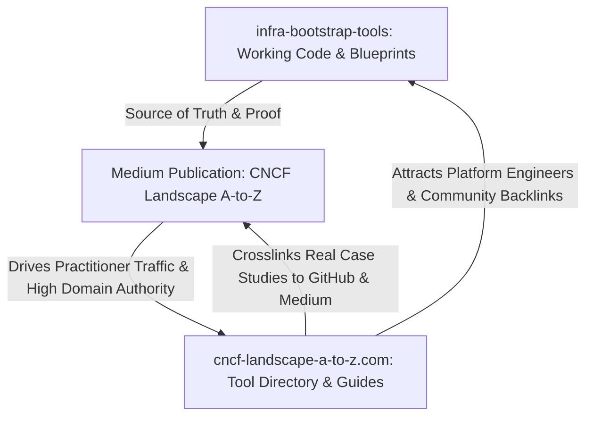

# The CNCF Landscape Visibility & Cross-Promotion Flywheel

This playbook details the cross-promotional mechanism used to convert working code in **`infra-bootstrap-tools`** into high-ranking technical articles on Medium that continuously drive traffic, backlinks, and authority to **[cncf-landscape-a-to-z.com](https://cncf-landscape-a-to-z.com/)**.

---

## The 3-Way Synergy Loop



### The Roles of Each Asset:
1. **`infra-bootstrap-tools` (The Proof Engine)**:
   * Where real cloud-native stacks (Flux D2, Dark K3s, KinD, OPA Rego) are built, debugged, and maintained.
   * Gives our articles credibility that pure theory or marketing posts cannot match.
2. **Medium Publication (The Distribution Engine)**:
   * Leverages Medium’s domain authority (`medium.com` DA 95+) to rank rapidly on Google for targeted cloud-native queries (e.g., *"Flux D2 architecture monorepo"*, *"K3s 0 open ports zero trust"*).
   * Reaches existing subscribers and cloud-native enthusiasts on Medium.
3. **`cncf-landscape-a-to-z.com` (The Owned Asset & Destination)**:
   * The primary beneficiary of all traffic and SEO authority.
   * Houses interactive tool cards, letter progress, and comprehensive category breakdowns.
   * Every Medium article embeds persistent CTAs, badges, and deep links driving readers to the corresponding tool profile on the site.

---

## In-Article Linking Blueprint: Funneling Readers to the Website

Every article published on Medium must include three strategic touchpoints connecting readers to `cncf-landscape-a-to-z.com`:

### 1. The Intro Header Banner
Place directly after the article introduction:
> 💡 *This article is part of the **[CNCF Landscape A-to-Z](https://cncf-landscape-a-to-z.com/)** initiative—demystifying over 1,000 cloud-native technologies. Explore our interactive directory and deep dive into other tools under **[Letter [X]](https://cncf-landscape-a-to-z.com/letters/[letter]/?utm_source=medium&utm_medium=article&utm_campaign=letter-[letter])**.*

### 2. Contextual In-Body Tool Link
When introducing the CNCF project in the body:
> *"[Tool Name] is an [Incubating/Graduated] project in the CNCF Landscape under the [Category] sector. You can view its full ecosystem context, maturity timeline, and related tools on the **[CNCF Landscape A-to-Z [Tool Name] Profile](https://cncf-landscape-a-to-z.com/tools/[tool-slug]/?utm_source=medium&utm_medium=article)**."*

### 3. The Concluding Call-to-Action (Footer)
At the end of the article, before the author bio:
> ---
> ### 🗺️ Explore the CNCF Landscape
> Looking to discover more tools in the cloud-native ecosystem?
> * 🔍 **Browse [Tool Name] & related tools**: Check out our curated profile on [cncf-landscape-a-to-z.com/tools/[tool-slug]/](https://cncf-landscape-a-to-z.com/tools/[tool-slug]/?utm_source=medium&utm_medium=article-footer)
> * 💻 **Get the working code**: The full implementation shown in this article is open-source and maintained in the [infra-bootstrap-tools repository on GitHub](https://github.com/xNok/infra-bootstrap-tools).
> * 📬 **Stay updated**: Subscribe to our bi-weekly newsletter on [cncf-landscape-a-to-z.com](https://cncf-landscape-a-to-z.com/) for bite-sized architecture breakdowns.

---

## Directory Backlink Operation: Updating `cncf-landscape-a-to-z.com`

When an article goes live on Medium, complete the reciprocal loop on the companion website:

1. **Update Tool Frontmatter in the Website Repo**:
   In `mekitmedia/cncf-landscape-a-to-z`, locate the tool's content file and add the new Medium story under `articles`:
   ```yaml
   articles:
     - title: "Why We Stopped Syncing Git Branches: Implementing Flux D2 in a Monorepo"
       author: "Alexandre Couëdelo"
       url: "https://medium.com/cncf-landscape-a-to-z/why-we-stopped-syncing-git-branches-..."
       date: "2026-11-09"
       type: "case-study"
       github_source: "https://github.com/xNok/infra-bootstrap-tools"
   ```
2. **Promote on Letter Index Page**:
   If the article matches the currently featured letter (e.g., Letter "F" for Flux), feature the article card at the top of the letter's landing page.
3. **Syndicate to Website Blog Feed**:
   Re-publish a summary version or excerpt on `cncf-landscape-a-to-z.com/posts/` setting the canonical URL to the Medium story.

---

## Social Promotion Checklist (Driving Dual Traffic)

When sharing articles on social channels (LinkedIn, X/Twitter, Reddit), always promote **both** the hands-on story and the website directory:

* **LinkedIn / X Post Formula**:
  1. **Hook**: The architectural challenge solved (e.g., *"Why exposing port 6443 in production is a bad idea"*).
  2. **The Fix**: 3 bullet points summarizing the solution implemented in `infra-bootstrap-tools`.
  3. **Dual Link CTA**:
     * 📖 Read the full deep-dive: `[Medium URL]`
     * 🗺️ Explore all Letter [X] tools in our interactive directory: `https://cncf-landscape-a-to-z.com/letters/[x]/`
     * 💻 Code repository: `https://github.com/xNok/infra-bootstrap-tools`
