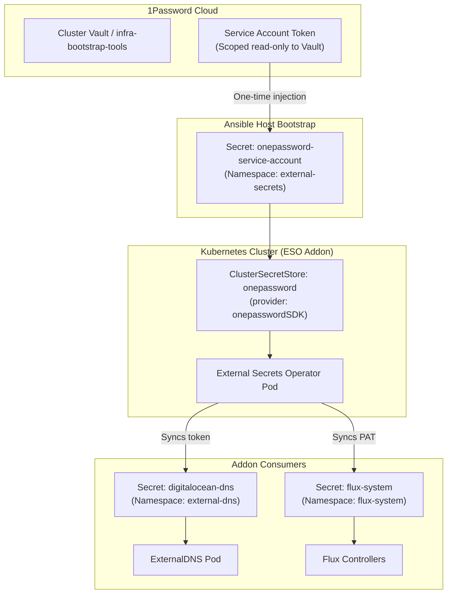

# GitOps Secret Management: External Secrets Operator & 1Password SDK

This document captures the design, architecture, and integration of the **External Secrets Operator (ESO)** with **1Password SDK** for the Dark K3s Stack.

---

## 1. Problem Statement & Motivation

Prior to ESO, secret management across the cluster relied on Ansible performing out-of-band secret retrieval and template injection:
1. **Ansible Secret Sprawl**: Ansible had to fetch credentials from 1Password and create distinct Kubernetes secrets for each component (`flux-system` dockerconfigjson, `cluster-env` ConfigMaps, DigitalOcean API tokens).
2. **Values Coupling**: Secrets needed to be pre-created by Ansible before HelmReleases could reconcile, coupling cluster bootstrap with application runtime.
3. **Rotation Overhead**: Rotating a secret in 1Password required manually running an Ansible playbook against the host.

By introducing **External Secrets Operator (ESO)** into `infra-addons`:
* Ansible's secret management scope is reduced to exactly **one single secret**: injecting the 1Password Service Account Token (`onepassword-service-account`).
* The cluster becomes self-sufficient: every addon or application declares its secrets as native Kubernetes `ExternalSecret` custom resources.
* Secrets are synchronized continuously and rotated automatically from 1Password.

---

## 2. Architecture: 1Password SDK vs. 1Password Connect

ESO supports two 1Password providers:

| Feature | 1Password Connect (Legacy) | 1Password SDK (Modern) |
| :--- | :--- | :--- |
| **In-cluster Architecture** | Requires running a stateful Connect Server + Sync container | **Zero extra infrastructure** (runs directly inside the ESO controller) |
| **Authentication** | Connect credentials file + Access token | **1Password Service Account Token** (`OP_SERVICE_ACCOUNT_TOKEN`) |
| **Vault Access** | Scoped at Connect server deployment | Scoped directly in 1Password Service Account permissions |
| **Suitability for K3s** | Heavyweight, unnecessary memory overhead for single-node / edge | **Lightweight, cloud-native, and ideal for lean K3s nodes** |

We adopt the **1Password SDK (`onepasswordSDK`)** provider.

---

## 3. Component Design & Decoupled Workflow



### Step 1: Ansible Provisions the Service Account Secret
During cluster bootstrap, Ansible creates:
```yaml
apiVersion: v1
kind: Secret
metadata:
  name: onepassword-service-account
  namespace: external-secrets
type: Opaque
stringData:
  token: "{{ k3s_flux_bootstrap_1password_service_account_token }}"
```

### Step 2: ESO ClusterSecretStore Configuration
In `kubernetes/infra-addons/components/external-secrets/`:
```yaml
apiVersion: external-secrets.io/v1
kind: ClusterSecretStore
metadata:
  name: onepassword
spec:
  provider:
    onepasswordSDK:
      vault: "{{ CLUSTER_VAULT_NAME }}"
      auth:
        serviceAccountSecretRef:
          name: onepassword-service-account
          namespace: external-secrets
          key: token
```

### Step 3: Consumer Addons Declare ExternalSecrets
For example, for **ExternalDNS**:
```yaml
apiVersion: external-secrets.io/v1beta1
kind: ExternalSecret
metadata:
  name: digitalocean-dns
  namespace: external-dns
spec:
  refreshInterval: 1h
  secretStoreRef:
    kind: ClusterSecretStore
    name: onepassword
  target:
    name: digitalocean-dns
    creationPolicy: Owner
  data:
    - secretKey: api-token
      remoteRef:
        key: "DigitalOcean"
        property: "credential"
```

---

## 4. Synergy with ExternalDNS and OpenZiti

* **ExternalDNS**: Consumes `Secret/digitalocean-dns` seamlessly generated by ESO, authenticates to DigitalOcean, and registers `ziti.nokwebspace.ovh`.
* **Zero Hardcoded Secrets**: Git contains only `ExternalSecret` definitions pointing to secret keys; all sensitive data lives exclusively in 1Password.
* **Cluster Portability**: Any new cluster simply needs a 1Password Service Account token pointing to its vault, and the entire secret hierarchy reconciles automatically.
