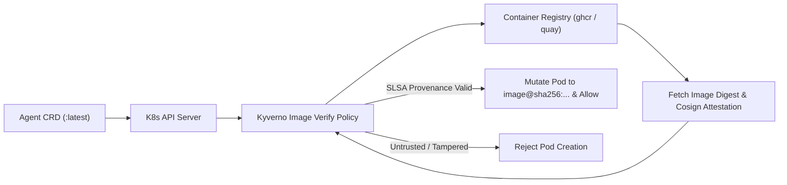

# Floating Container Tags with SHA & SLSA Provenance Validation

## 1. Context & Problem Statement

In GitOps and agentic platforms (such as [KubeOpenCode](https://github.com/kubeopencode/kubeopencode)), it is standard practice to configure workloads to track floating tags (e.g. `:latest`, `:edge`, or branch heads) so developer tooling and agent runtimes automatically receive bug fixes and feature updates without manual version bumps.

However, relying strictly on unverified floating tags introduces supply chain risks:
1. **Lack of Immutability**: Two cluster nodes pulling `:latest` at different times may run different binaries.
2. **Untrusted Upstream Updates**: If an upstream registry or image repository is compromised, malicious code could run without detection.
3. **Auditability**: Hard to prove which exact commit and build pipeline produced the binary running on the cluster.

Simply freezing tags to static semver or pinning rigid digests solves immutability, but defeats the goal of continuously tracking HEAD in rapid-iteration agentic workflows.

**Solution**: Allow floating tags, but enforce **cryptographic SHA digest verification and SLSA (Supply-chain Levels for Software Artifacts) provenance validation** before allowing the container to run on the cluster.

---

## 2. Goals & Requirements

- Allow GitOps manifests and `AgentTemplate` CRDs to reference floating tags (`:latest`).
- Automatically resolve the floating tag to its exact immutable digest (`@sha256:...`).
- Verify SLSA provenance and Cosign/Sigstore attestations against trusted signing identities (e.g., GitHub Actions OIDC issuer for `quay.io/kubeopencode/*` or internal images).
- Reject execution at admission time or during Flux reconciliation if provenance or signature verification fails.

---

## 3. Tooling Evaluation

| Tool / Mechanism | Layer | How It Works | Fit for K3s Dark Stack |
| :--- | :--- | :--- | :--- |
| **Kyverno Image Verification** | Admission Controller (Kubernetes) | Intercepts Pod creation; verifies Cosign signatures, SLSA provenance attestations, and mutates `:latest` tags to their verified `@sha256:...` digest. | **High** - Lightweight, native K8s CRD policies, supports Sigstore/Cosign without external agents. |
| **Flux Image Automation Controller** | GitOps Controller (Flux) | Scans registries for tag changes, resolves immutable SHA digests, and commits the pinned digest back to Git automatically. | **High** - Built into the Flux ecosystem; provides full GitOps audit trail of all tag updates in git history. |
| **Sigstore Policy Controller** | Admission Controller | Dedicated Sigstore admission controller checking Cosign signatures and Rekor transparency logs. | **Medium** - More specialized than Kyverno, requires connectivity to Sigstore TUF roots. |

---

## 4. Proposed Architecture (Kyverno + Cosign / SLSA)



### Example Kyverno Policy Spec
```yaml
apiVersion: kyverno.io/v1
kind: ClusterPolicy
metadata:
  name: verify-kubeopencode-provenance
spec:
  validationFailureAction: Enforce
  rules:
    - name: verify-image-attestation
      match:
        any:
          - resources:
              kinds:
                - Pod
      verifyImages:
        - imageReferences:
            - "quay.io/kubeopencode/*"
          mutateDigest: true # Automatically rewrites :latest to verified @sha256 digest!
          verifyDigest: true
          required: true
          attestations:
            - type: https://slsa.dev/provenance/v0.2
              conditions:
                - all:
                    - key: "{{ builder.id }}"
                      operator: Equals
                      value: "https://github.com/slsa-framework/slsa-github-generator/.github/workflows/generator_generic_slsa3.yml@*"
```

---

## 5. Implementation Roadmap

1. **Phase 1: Registry Digest Resolution via Flux (GitOps-side)**:
   - Evaluate `flux-system` `ImageRepository` and `ImagePolicy` controllers to resolve floating tags and record digests.
2. **Phase 2: Admission-Time Verification (Cluster-side)**:
   - Evaluate deploying `kyverno` as an infra-addon on K3s.
   - Author `ClusterPolicy` rules verifying OIDC signatures for upstream agent runtimes.
3. **Phase 3: Automated Keyless Signing for Internal Artifacts**:
   - Integrate GitHub Actions with Sigstore/Cosign keyless signing using GitHub OIDC tokens for our own published containers and OCI charts.
