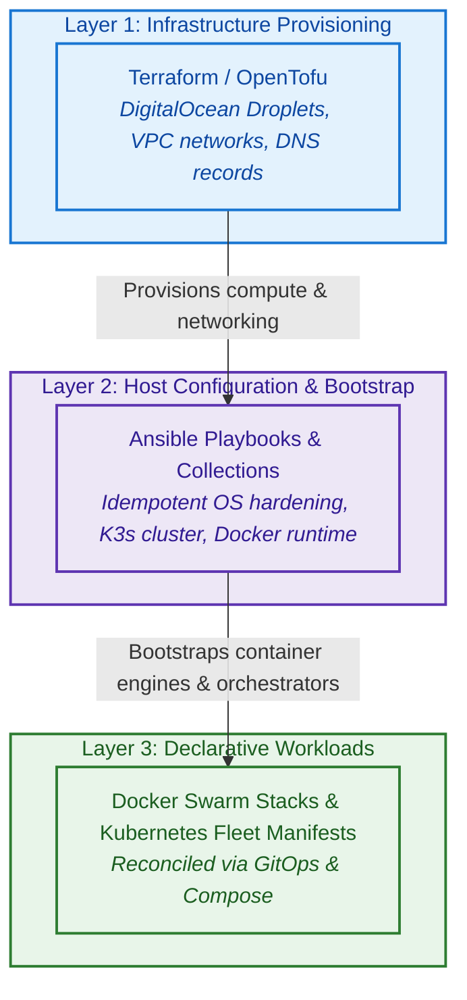

# 6 Infrastructure as Code Quality Patterns for Production-Grade Repositories

When I first started [`infra-bootstrap-tools`](https://github.com/xNok/infra-bootstrap-tools), it was simply my personal playground. I needed to manage my OVH webserver on which I was running my experiments for my Master's 10 years ago. Ever since then, I always have had a server to manage some automation—mostly n8n for a very long time, and some custom applications I have built. Having a place you deploy and costs you a few bucks a month is a nerd dream.

This has also been my launchpad into my DevOps career. I have learned so much in the journey, wrote countless articles, and landed side gigs as a tech writer. But this is maybe too much blabbering! Today, I wanted to look back and see what I consider I did well on this repo and the key decisions I abide as cornerstones in my work.

In modern application engineering, we take comprehensive unit tests, type checkers, hermetic build environments, and granular release management for granted. Why should our **Infrastructure as Code (IaC)** be treated with any less rigor?

Over the years, I've treated `infra-bootstrap-tools` as an engineering lab to tackle these friction points head-on. In this article, I want to walk you through **6 key quality patterns** I've implemented across the repository that elevate IaC from fragile glue scripts into a robust, production-grade system.

Let's dig in!

---

## 1. Policy-as-Code Hardening for CI/CD Pipelines

Ever since [Conftest](https://www.conftest.dev/) and Open Policy Agent (OPA) came out, I knew it was big and I introduced it in my company: OPA and Conftest for everything—OPA policy in Terraform Atlantis runners, OPA in K8s repos, OPA in GitLab pipelines, and maybe more.

This one shift stopped repos from going out of hand and helped define conventions. For instance, setting naming conventions in stone with policy saved me many headaches. The goal was never security (it does help), but instead of telling "this is the convention", a policy would enforce it for me and state when it is broken.

Conftest is awesome as it parses many, many configuration languages. Any arbitrary pattern you define and want your team to stick with can become a policy. That can do anything, but if they stray from the golden path they need to write a policy exception and state clearly in the repo code why they did it differently. And this pattern is much, much better than any ADR ever written by a human or an AI. No one reads ADRs; here the policy exception is in the folder that is breaking the rule.

In `infra-bootstrap-tools`, every workflow under `.github/workflows/` is statically tested against our policy rules defined in `policies/ci/`:

- **Pinning Third-Party Actions to Immutable SHAs ([`pinned_actions.rego`](https://github.com/xNok/infra-bootstrap-tools/blob/main/policies/ci/pinned_actions.rego))**: Floating tags like `@v4` can be moved or compromised. We require all third-party GitHub Actions and reusable workflows to be pinned to full 40-character commit SHAs (with a human-readable tag comment, e.g. `uses: actions/checkout@11d5960a326... # v4`).
- **Least-Privilege Job Permissions ([`job_permissions.rego`](https://github.com/xNok/infra-bootstrap-tools/blob/main/policies/ci/job_permissions.rego))**: Every job must declare an explicit `permissions:` block rather than inheriting broad default repository token permissions.
- **Mandatory Job Timeouts ([`job_timeout.rego`](https://github.com/xNok/infra-bootstrap-tools/blob/main/policies/ci/job_timeout.rego))**: Runaway build minutes cost real money. Every job must define an explicit `timeout-minutes` threshold (defaulting to 15 minutes).
- **No Multiline Inline Scripts ([`inline_scripts.rego`](https://github.com/xNok/infra-bootstrap-tools/blob/main/policies/ci/inline_scripts.rego))**: We strictly prohibit writing multiline shell snippets directly inside YAML `run:` blocks.

Here is an excerpt from [`policies/ci/inline_scripts.rego`](https://github.com/xNok/infra-bootstrap-tools/blob/main/policies/ci/inline_scripts.rego) written in Rego v1:

```rego
package main

import rego.v1

# Deny any run step that contains a newline, suggesting it is a multiline inline script
deny contains msg if {
  some job_id
  job := input.jobs[job_id]

  some step_index
  step := job.steps[step_index]

  step.run
  contains(step.run, "\n")

  step_name := object.get(step, "name", sprintf("step %v", [step_index]))
  msg := sprintf("Job '%v' step '%v' contains a multiline inline script. Please extract this into a dedicated script in the `bin/ci` directory.", [job_id, step_name])
}
```

By running `conftest test .github/workflows/ -p policies/ci/` during CI validation, compliance deviations are caught immediately.

> If an architectural standard isn't enforced by a policy engine, it's not a standard—it's just a wish.

---

## 2. Decoupled CI Execution & Automated Shell Script Testing (BATS)

I have always hated to see inline bash or Python or any other language in the pipeline because I know for a fact those are untested and unlinted code. There is nothing worse than knowing things can be unreliable.

The other thing is the big missed opportunity: if a script is useful in CI, it should also be useful for me to do things when I need to. I should never have to write a script to do something the CI does, like building an image.

So my rule of thumb is that CI should be calling a build tool—Maven, Just, or Make. If that doesn't apply, then write a script: it should work locally, and it should be tested. But how do you test bash? Surprisingly, not many people know that bash has a test framework: the same way Python has pytest, bash has [BATS](https://github.com/bats-core/bats-core)—and it is great.

When you adopt this pattern, your CI pipelines become remarkably clean. Instead of fifty lines of inline bash nested inside GitHub Actions YAML, every job simply calls a self-contained script:

```yaml
# .github/workflows/website.yml
- name: Build Website
  run: ./bin/ci/build-website.sh "${HUGO_VERSION}" "${{ runner.temp }}" "${{ steps.pages.outputs.base_url }}"
```

From a developer experience point of view, this changes everything:

- **Zero "commit-and-pray"**: If something breaks, you don't push twenty dummy commits to GitHub Actions just to debug a typo. You run the exact script locally on your machine with immediate feedback:
  ```bash
  ./bin/ci/build-website.sh 0.147.3 /tmp http://localhost:1313
  ```
- **Fast local test feedback**: You can test your shell scripts before pushing code with BATS:
  ```bash
  bats bin/tests/ci/
  ```

In GitHub Actions, running the entire test suite is just as simple:

```yaml
# .github/workflows/bats.yml
- name: Run BATS tests
  run: ./bin/ci/lib/run-bats-tests.sh
```

> If a script is useful in CI, it must be runnable locally. Decoupling CI execution gives you clean pipelines and instant feedback loops.

---

## 3. Hermetic & Reproducible Development Environments (Nix Flakes & Flox)

This has been my longest quest in software development. I have tried many solutions, and until a few years back none really felt right—Docker is definitely not the solution to everything. In [The Holy Grail of Development Environments: My Journey to Nix](/blog/journey-to-nix/), I covered the topic in depth, sharing how I bounced between bloated Docker toolchains (`tools.sh`) and custom bash installer scripts (`ibt`). Both kept falling short because of container startup lag, maintenance overhead, or platform incompatibilities between macOS, Ubuntu, and cloud workspaces.

The solution that completely eliminated "works on my machine" in this repository is **Nix Flakes** (with **Flox** support as a lightweight alternative).

Instead of forcing a single monolithic 10GB environment on every contributor, our [`flake.nix`](https://github.com/xNok/infra-bootstrap-tools/blob/main/flake.nix) dynamically maps targeted shell profiles defined in [`bin/nix/common.nix`](https://github.com/xNok/infra-bootstrap-tools/blob/main/bin/nix/common.nix):

- `nix develop .#docs`: Loads Go, Hugo, and site linters.
- `nix develop .#ansible`: Loads Ansible, `ansible-lint`, and 1Password CLI.
- `nix develop .#flux`: Loads `kubectl`, `helm`, `kind`, and `fluxcd`.
- `nix develop .#default`: Loads common utilities (Git, pre-commit, `tenv` for Terraform version management, BATS, Conftest).

```bash
# Jump straight into the docs environment with the exact pinned Hugo version
nix develop .#docs

# Or run commands directly inside the hermetic shell
nix develop .#docs --command hugo server
```

For contributors who prefer an environment manifest, we also provide a declarative [Flox](https://flox.dev/) environment in `.flox/env/manifest.toml`.

No installation guides, no conflicting system libraries—just bit-for-bit reproducibility everywhere.

---

## 4. Layered Architecture & Declarative Idempotency

When you first begin orchestrating infrastructure, the temptation is to build a single "God Playbook": provision the cloud VM, configure firewall rules, install the container runtime, and deploy the application all in one giant run.

The moment something fails in step 47, your server is stuck in an inconsistent intermediate state. Did the firewall lock you out? Are the container mounts half-created? Is the VM properly tagged?

To eliminate this fragility, we enforce a strict separation of concerns across three distinct architectural layers:



- **Layer 1: Provisioning (Terraform)**: Solely responsible for cloud infrastructure lifecycles (VMs, VPCs, DNS). State is locked in a remote backend, treating virtual hardware as disposable, immutable resources.
- **Layer 2: OS Configuration & Cluster Bootstrap (Ansible)**: Idempotently configures host settings, sysctl parameters, firewall rules (UFW), and cluster manager/agent nodes.
- **Layer 3: Workload Deployment (Docker Swarm / Kubernetes)**: Pure declarative stack and fleet manifests managed via GitOps. Application updates never touch host packages or OS configurations.

Every layer operates with strict boundaries and declarative idempotency. Backed by strict linting (`.ansible-lint`, `.yamllint.yaml`, `.terraform-version`), if you rerun our main playbooks against an already configured cluster, every single task reports `ok: 0 changed: 0`.

---

## 5. Multi-Granular Tree Release Strategy & Bill of Materials (BOM) Management

Release management in a polyglot infrastructure monorepo is notoriously tricky. This repository contains Ansible collections, individual Ansible roles, Docker Swarm stacks, and Python agent utilities.

In [Intentional Releases: Why I Chose Changesets over Semantic-Release](/blog/intentional-releases-changesets/), I explained why purely automated commit parsing (like `semantic-release`) fails for infrastructure. It produces noisy changelogs full of commit hashes rather than communicating actual architectural intent to users.

To solve this, we implemented a **Hierarchical Tree Release Architecture** using npm workspaces and [Changesets](https://github.com/changesets/changesets), even though this repository contains virtually no Node.js code:

### Multi-Level Package Architecture

1. **Leaf Level (Individual Components)**: Every standalone role (e.g., `ansible/roles/docker`, `ansible/roles/k3s_server`) and stack maintains its own `package.json` with independent semantic versioning.
2. **Aggregator Level (Bill of Materials - BOM)**: Parent directories like [`ansible/package.json`](https://github.com/xNok/infra-bootstrap-tools/blob/main/ansible/package.json) act as a **Bill of Materials (BOM)**. They pin the exact tested versions of all underlying roles:

```json
{
  "name": "ansible-collection-infra-bootstrap-tools",
  "private": true,
  "version": "1.1.0",
  "workspaces": [
    "roles/*"
  ],
  "dependencies": {
    "ansible-role-docker": "0.0.2",
    "ansible-role-k3s-server": "0.1.3",
    "ansible-role-utils-rotate-docker-secrets": "0.0.1",
    "ansible-role-utils-affected-roles": "0.0.3"
  }
}
```

3. **Automated Tree Cascading**: When you submit a PR, Changesets prompts you for an intentional change description (`yarn changeset`). If you bump `ansible-role-docker`, Changesets automatically bubbles that bump up to the parent `ansible-collection-infra-bootstrap-tools` BOM package!

Consumers can choose to pin an individual role, or simply reference the parent collection BOM knowing that all constituent roles have been tested together.

---

## 6. Defense-in-Depth Secret Hygiene: 1Password CLI, direnv & Dynamic Injection

Hardcoding passwords or long-lived API tokens inside infrastructure playbooks is an obvious security hazard. But even keeping plaintext `.env` files or decrypted secret keys on developer laptops creates an unnecessary attack surface.

In `infra-bootstrap-tools`, we treat secret hygiene with true defense-in-depth, relying heavily on [1Password CLI (`op`)](https://developer.1password.com/docs/cli/get-started/) and [direnv](https://direnv.net/) across every stage of our workflow:

### 1. Zero Plaintext Secrets on Disk via `direnv` and `op run`
Instead of maintaining hazardous `.env` files with raw API keys or database tokens on disk, our project's [`.envrc`](https://github.com/xNok/infra-bootstrap-tools/blob/main/.envrc) integrates `direnv` with the 1Password CLI. 

Environment variables use 1Password secret references (`op://vault/item/field`). When running commands or launching tools, `op run` dynamically resolves those references into environment variables directly in process memory:
```bash
# Injects secrets into memory on the fly—zero credentials written to disk
op run --env-file=.env.template -- terraform plan
```
When you exit the directory or the process terminates, the credentials vanish from memory.

### 2. Hardware-Backed SSH Agent & Git Commit Signing
We never store unencrypted SSH private keys in `~/.ssh`. Instead, the 1Password desktop app acts as our system SSH agent via `~/.1password/agent.sock`.

Our SSH config routes all hosts through this socket:
```text
Host *
  IdentityAgent ~/.1password/agent.sock
```
Every SSH connection to remote servers queries 1Password for biometric/system authorization. Furthermore, every Git commit in this repo is cryptographically signed using `op-ssh-sign`, ensuring verifiable provenance without exposing key material.

### 3. Runtime Secret Lookups in Ansible Playbooks
When Ansible needs to bootstrap secrets—such as pulling GitHub tokens to configure Flux or inject cluster secrets—we avoid committing Ansible Vault files with shared passwords.

Instead, roles like [`k3s_flux_bootstrap`](https://github.com/xNok/infra-bootstrap-tools/blob/main/ansible/roles/k3s_flux_bootstrap/README.md) and [`utils_ssh_add`](https://github.com/xNok/infra-bootstrap-tools/blob/main/ansible/roles/utils_ssh_add/README.md) use the `community.general.onepassword` lookup plugin:
```yaml
- name: Retrieve GitHub Flux Token from 1Password
  ansible.builtin.set_fact:
    github_token: "{{ lookup('community.general.onepassword', 'GitHub_Flux_Token', field='password') }}"
```
Secrets are retrieved in real-time from 1Password on the operator's machine and piped directly into the target cluster without ever being written to a temporary file.

### 4. Zero-Downtime Secret Rotation in Docker Swarm
For containerized services running on Docker Swarm, secrets shouldn't be left as static config files on remote nodes. We built dedicated utility roles like [`ansible/roles/utils_rotate_docker_secrets`](https://github.com/xNok/infra-bootstrap-tools/blob/main/ansible/roles/utils_rotate_docker_secrets/README.md) and `utils_rotate_docker_configs`.

When an API token or database password changes, the role:
1. Creates a newly versioned secret in Swarm (e.g. `db_password_20260415`).
2. Updates the Swarm service definition to attach the new secret.
3. Orchestrates a rolling service update with zero downtime.
4. Prunes the deprecated secret once all tasks are healthy.

### 5. Automated Pre-Commit Guardrails
As a final safety net, our `.pre-commit-config.yaml` runs `detect-private-key` before any git commit can be finalized. If an engineer accidentally stages a private key or certificate, the commit is blocked before it ever touches Git history.

---

## Bringing It All Together

High quality in Infrastructure as Code isn't about finding a single silver-bullet tool. It’s about building a cohesive culture of craftsmanship across your entire automation pipeline:

| Quality Pattern | Tooling | Problem Solved |
| :--- | :--- | :--- |
| **1. Policy-as-Code** | Conftest & Rego v1 | Supply chain security, SHA pinning, timeout enforcement |
| **2. Decoupled CI & Shell Testing** | BATS & Bash Strict Mode | Elimination of commit-and-pray loops and unverified glue scripts |
| **3. Hermetic Environments** | Nix Flakes & Flox | "Works on my machine" syndrome and cross-platform drift |
| **4. Layered Modularity** | Terraform + Ansible + Stacks | Fragile monolithic playbooks and non-idempotent configurations |
| **5. Tree & BOM Releases** | Changesets & Workspaces | Granular role versioning with coordinated collection releases |
| **6. Secret Hygiene & Dynamic Injection** | 1Password CLI, direnv & Rotation Roles | Plaintext credential leaks, disk persistence, and zero-downtime rotation |

If you treat your infrastructure automation with the same engineering rigor you give to production software, your systems will be more reliable, testable, and maintainable.

You can explore all of these patterns in action in the [`infra-bootstrap-tools`](https://github.com/xNok/infra-bootstrap-tools) repository. Let me know your favorite IaC patterns or how you tackle CI/CD hygiene in your own setups!

