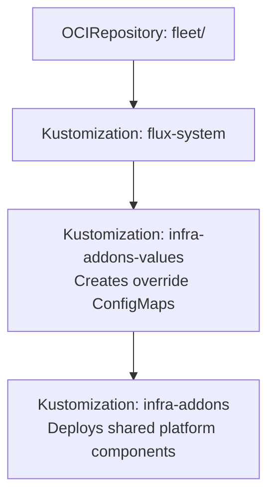

## Overview

Traditional GitOps patterns typically bind a cluster directly to a Git repository branch. While simple, this creates challenges in monorepos: every cluster rebuilds when unrelated files change, cluster credentials must be shared across CI systems, and promotion requires branch-merging gymnastics.

`infra-bootstrap-tools` implements the **ControlPlane Enterprise Flux D2 Architecture**, adapted specifically for a clean monorepo workflow.

Instead of syncing directly from Git branches, clusters pull versioned, signed **OCI artifacts** directly from GitHub Container Registry (`ghcr.io`).

---

## Dual OCI Artifact Design


On every push to `main`, GitHub Actions automatically packages and pushes two distinct OCI artifacts:

- **Fleet Artifact (`oci://ghcr.io/.../fleet/<cluster>:latest`)**: Cluster-specific artifact that bootstraps the cluster, defines `OCIRepositories`, delivers environment ConfigMap overrides, and sets root Kustomization entrypoints.
- **Infra-Addons Artifact (`oci://ghcr.io/.../infra-addons:latest`)**: Shared artifact containing base Kustomize components, HelmRepositories, default values, and platform add-ons (Cert-manager, OpenZiti, etc.).

### Directory Structure in the Monorepo

```
kubernetes/
├── fleet/
│   ├── k3s/                      # Production K3s bare-metal / cloud cluster
│   │   ├── flux-system/          # FluxInstance and operator bootstrap
│   │   ├── infra-addons/         # Cluster-specific sources & kustomizations
│   │   └── infra-addons/values/  # Per-cluster value overrides (e.g. ziti-router)
│   └── kind/                     # Local test cluster (matches k3s structure)
└── infra-addons/
    ├── base/                     # Shared Helm repositories (jetstack, openziti)
    └── components/               # Opt-in Kustomize Components (kind: Component)
        ├── cert-manager/
        ├── openziti/
        └── keycloak/
```

---

## Reconciliation Dependency Chain

To ensure resources are created in strict logical order (sources before values, and values before HelmReleases), Flux reconciles through a defined dependency tree:



1. **`flux-system`**: Reads the cluster's fleet OCI artifact.
2. **`infra-addons-values`**: Applies the cluster's override `ConfigMap` resources into the `flux-system` namespace.
3. **`infra-addons`**: Activates shared Kustomize components from the `infra-addons` OCI artifact, utilizing the override ConfigMaps generated in step 2.

---

## The Values Layering Rule

> [!CAUTION]
> **Never use `spec.values` inside a Flux `HelmRelease`.**
> In the Flux Helm Controller, inline values declared in `spec.values` take unconditional precedence over any values provided by `valuesFrom`. If you place default configurations inside `spec.values`, cluster-specific overrides cannot override them!

Instead, we use exclusively **`valuesFrom` with two distinct layers**:

```yaml
# In component HelmRelease (e.g. cert-manager or ziti-controller)
spec:
  valuesFrom:
    - kind: ConfigMap
      name: default-cert-manager-values         # 1. Base default (from infra-addons)
    - kind: ConfigMap
      name: ${CLUSTER_NAME}-cert-manager-values # 2. Cluster override (from fleet)
      optional: true                            # Optional: missing means use default
```

- **Layer 1 (Component Default)**: Generated automatically by `configMapGenerator` in `infra-addons/components/<addon>/kustomization.yaml`. Contains sensible baselines that work for any cluster.
- **Layer 2 (Cluster Override)**: Generated by `configMapGenerator` in `fleet/<cluster>/infra-addons/values/`. Marked `optional: true`. If absent, defaults apply cleanly.
- **Dynamic Cluster Name**: `${CLUSTER_NAME}` is substituted dynamically at runtime via `postBuild.substituteFrom: flux-runtime-info`.

---

## Hard-Earned GitOps Lessons & Gotchas

### 1. The ConfigMap Watch Annotation
By default, Flux's `HelmRelease` only polls for changes on its configured `interval` timer (e.g. every 1 hour). If you update a values ConfigMap, the HelmRelease will silently ignore it until the timer elapses.

**The Fix**: Add the `reconcile.fluxcd.io/watch: Enabled` annotation to every ConfigMap used in `valuesFrom`. We enforce this globally in Kustomize via `generatorOptions`:

```yaml
generatorOptions:
  disableNameSuffixHash: true
  annotations:
    reconcile.fluxcd.io/watch: Enabled
configMapGenerator:
  - name: default-cert-manager-values
    namespace: flux-system
    files:
      - values.yaml=default-cert-manager.values.yaml
```

### 2. Variable Escaping in Kustomize `postBuild`
When using `postBuild.substituteFrom` to inject cluster names or runtime metadata, Flux processes **all** `${VAR}` patterns across all generated manifests—including shell scripts stored inside ConfigMaps!

If a script like `enroll-router.sh` contains `${SA_TOKEN}`, Flux attempts to substitute it with an empty string, breaking the bash script at runtime.

**The Fix**: Escape all shell variables with double dollar signs (`$$VAR`):
```bash
# In enroll-router.sh source file:
SA_TOKEN=$$(cat /var/run/secrets/kubernetes.io/serviceaccount/token)
JWT_B64=$$(echo -n "$${JWT}" | base64 -w 0)
```
Flux transforms `$$VAR` into `${VAR}` during reconciliation, perfectly preserving shell semantics.

### 3. Namespace Placement
All `HelmRelease` manifests reside inside the `flux-system` namespace, with `spec.targetNamespace` pointing to the application namespace (e.g. `openziti`, `cert-manager`):
```yaml
metadata:
  namespace: flux-system   # Flux manages it here
spec:
  targetNamespace: openziti # Chart installs workloads here
```
This guarantees that all `valuesFrom` ConfigMaps remain co-located with their managing HelmReleases in `flux-system`.

---

## Platform Add-ons & Identity Services

The `kubernetes/infra-addons` directory hosts reusable platform components packaged as Kustomize components (`kind: Component`). These components provide essential shared services:
- **`cert-manager`**: Automates TLS certificate issuance and renewal.
- **`trust-manager`**: Distributes trust bundles (CAs) across namespaces.
- **`keycloak`**: Provides local OIDC authentication and user management.
- **`openziti`**: Integrates external identity providers via JWT signers.

Clusters opt-in to these components declaratively in their `infra-addons/1-kustomize.yaml` manifest.

### Cert-Manager & Trust-Manager mTLS Infrastructure

Zero-trust networking relies heavily on mutual TLS (mTLS). To establish trust between the OpenZiti Controller, Edge Routers, and cluster workloads, certificates must be issued dynamically and trusted cluster-wide:

| Component | Responsibility in Trust Infrastructure |
|---|---|
| **cert-manager** | Generates CA and service certificates, installs CRDs via Helm values, and manages automated renewals |
| **trust-manager** | Reads root CA from trust namespace, projects unified `Bundle` CRDs into target ConfigMaps across all nodes |

#### The `--trust-namespace` Gotcha
`trust-manager` reads secret sources for its `Bundle` resources from a single, designated trust namespace configured at startup via `--trust-namespace`.

1. The default component configuration (`default-trust-manager.values.yaml`) ships with `app.trust.namespace: cert-manager` (safe baseline).
2. However, the OpenZiti Controller Helm chart generates its root CA secret (`edge-signer-secret`) directly inside the **`openziti`** namespace.
3. If trust-manager attempts to read a Bundle source located in `openziti` while configured for `cert-manager`, bundle reconciliation fails silently.

**The Solution**: Clusters deploying OpenZiti must override this value in their fleet values:
```yaml
# fleet/<cluster>/infra-addons/values/trust-manager.values.yaml
app:
  trust:
    namespace: openziti
```

#### Handling CRD Ordering with `dependsOn`
The `ziti-controller` Helm chart deploys a `trust.cert-manager.io/v1alpha1 Bundle` resource. On a fresh cluster bootstrap, this will fail if trust-manager hasn't finished registering its CRDs:
```yaml
spec:
  dependsOn:
    - name: trust-manager
      namespace: flux-system
```

### Human Identity: Keycloak vs. Auth0 OIDC

Workload authentication is handled cryptographically via OpenZiti identity certificates. For human operator access, OpenZiti supports **External JWT Signers** via OpenID Connect (OIDC):

- **Local Testing (Keycloak)**: In Kind or local testbeds, an in-cluster Keycloak deployment (`quay.io/keycloak/keycloak:25.0.6`) provides OIDC authentication with a custom `ziti` realm imported declaratively on boot.
- **Production (Auth0 External IdP)**: In cloud environments, OpenZiti integrates directly with external enterprise identity providers like **Auth0**. An External JWT Signer registers the Auth0 tenant domain, verifies bearer JWT signatures via JWKS endpoints (`/.well-known/jwks.json`), maps claims to Ziti roles, and grants access without storing passwords in the cluster.

